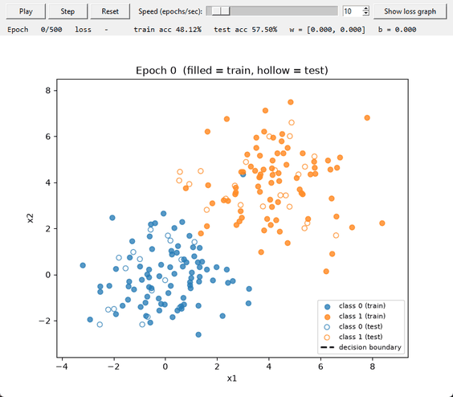
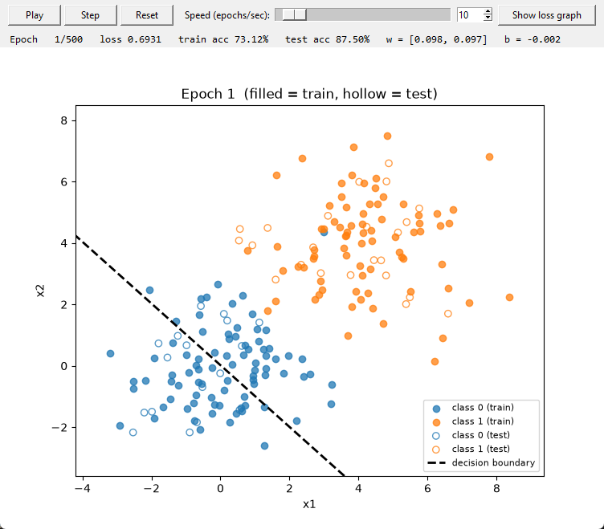
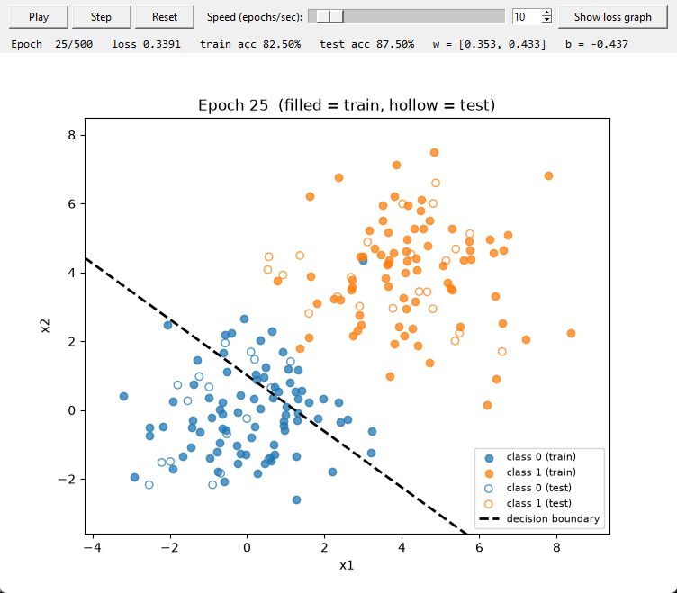
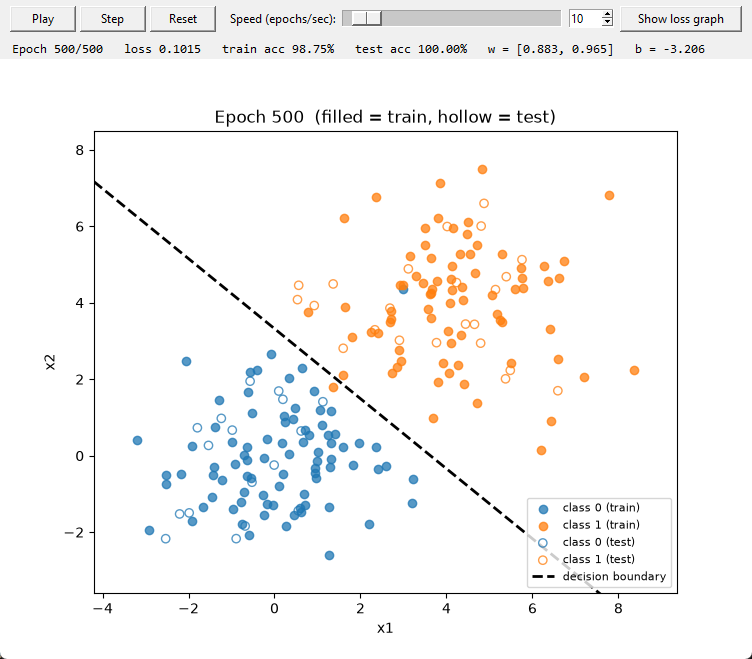
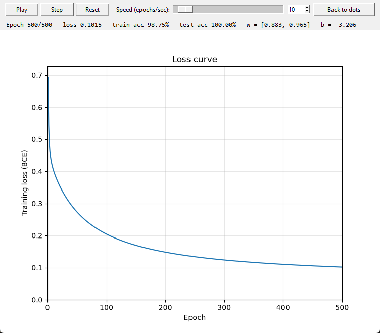

# NumPy Logistic Classifier


A binary logistic regression classifier built from scratch with **pure NumPy**: no scikit-learn, no PyTorch. It is trained with batch gradient descent on binary cross-entropy loss and evaluated on a synthetic 2D dataset. The project includes an interactive GUI that shows the decision boundary moving into place epoch by epoch.

<p align="center">
  
</p>

---

## Highlights

- **Built from first principles.** Sigmoid, binary cross-entropy, gradients, and the update rule are each written as a small, readable function.
- **Vectorized.** One matrix operation handles all training examples at once (`z = X @ w + b`); there are no per-sample Python loops.
- **Live training visualizer.** You can watch the decision boundary update in real time, with adjustable speed, play, pause, single-step, and reset controls, plus a live loss curve.
- **Proper evaluation.** The data is shuffled and split 80/20 with a fixed seed so results are reproducible, and accuracy is reported on both the training and test sets.

## Results

| Metric | Value |
|---|---|
| Training accuracy | **98.75%** (160 points) |
| Test accuracy | **100.00%** (40 points) |
| Final training loss | 0.1015 |
| Learned parameters | `w = [0.883, 0.965]`, `b = -3.206` |

The classes are two Gaussian clouds that overlap slightly, so a few training points sit on the wrong side of any straight line. The test set is small, so each test point is worth 2.5% accuracy.

## How it works

Each point has two features, $x = (x_1, x_2)$, and a label $y \in \lbrace 0, 1 \rbrace$.

**1. Linear score:** a weighted sum of the features plus a bias:

$$z = w_1 x_1 + w_2 x_2 + b$$

**2. Sigmoid:** squashes the score into a probability between 0 and 1:

$$p = \sigma(z) = \frac{1}{1 + e^{-z}}$$

**3. Binary cross-entropy loss:** penalizes wrong predictions, especially confident ones. It is averaged over all $n$ training points:

$$L = -\frac{1}{n}\sum_{i=1}^{n}\Big[y_i \log p_i + (1 - y_i)\log(1 - p_i)\Big]$$

**4. Gradients:** the derivatives of sigmoid and cross-entropy simplify to the prediction error $(p - y)$:

$$\frac{\partial L}{\partial w} = \frac{1}{n} X^\top (p - y) \qquad \frac{\partial L}{\partial b} = \frac{1}{n}\sum_{i=1}^{n}(p_i - y_i)$$

**5. Update:** take a small step against the gradient, scaled by the learning rate $\eta$:

$$w \leftarrow w - \eta \frac{\partial L}{\partial w} \qquad b \leftarrow b - \eta \frac{\partial L}{\partial b}$$

These five steps are repeated for every epoch. A point is classified as class 1 when $p \ge 0.5$, which is equivalent to $z \ge 0$. The decision boundary is therefore the straight line $w_1 x_1 + w_2 x_2 + b = 0$.

## Screenshots

<table>
  <tr>
    <td align="center"><br><b>Epoch 1</b>: the boundary cuts through class 0 (73% train accuracy)</td>
    <td align="center"><br><b>Epoch 25</b>: the bias is learning, so the line slides upward</td>
  </tr>
  <tr>
    <td align="center"><br><b>Epoch 500</b>: the boundary has settled in the gap (98.75% / 100%)</td>
    <td align="center"><br><b>Loss curve</b>: training loss decreasing over 500 epochs</td>
  </tr>
</table>

Filled markers are training points. Hollow markers are held-out test points that the model never trains on.

## Getting started

**Requirements:** Python 3.10+

```bash
git clone https://github.com/aydsman/NumPy-Logistic-Classifier.git
cd NumPy-Logistic-Classifier
python -m pip install -r requirements.txt
```

**Train and evaluate.** This prints the loss and final accuracy, then shows static plots:

```bash
python main.py
```

**Launch the live visualizer:**

```bash
python visualize.py
```

| Control | Action |
|---|---|
| **Play / Pause** | Start or stop training |
| **Step** | Run exactly one epoch |
| **Reset** | Set the weights back to zero |
| **Speed** | Epochs per second (1–200), set with the slider or by typing a value |
| **Show loss graph** | Switch to the live loss curve and back; training continues on either screen |

## Configuration

All hyperparameters are constants at the top of [`main.py`](main.py):

| Constant | Default | Description |
|---|---|---|
| `SEED` | `42` | Random seed for reproducible data and shuffling |
| `N_DOTS` | `200` | Total number of points (split evenly between the two classes) |
| `CENTER_0`, `CENTER_1` | `(0, 0)`, `(4, 4)` | Centers of the two classes |
| `SPREAD` | `1.5` | Standard deviation of each cloud; higher values mean more overlap |
| `TRAIN_FRACTION` | `0.8` | Fraction of points used for training |
| `LEARNING_RATE` | `0.1` | Gradient descent step size |
| `EPOCHS` | `500` | Number of full passes over the training set |

## Project structure

```
NumPy-Logistic-Classifier/
├── main.py           # Model, training loop, evaluation, static plots
├── visualize.py      # Tkinter GUI for live training visualization
├── requirements.txt
└── assets/           # Screenshots and GIF used in this README
```

**`main.py` functions**

| Function | Purpose |
|---|---|
| `make_data` | Generate two Gaussian clouds of labeled points |
| `split` | Shuffle and split into train and test sets |
| `linear`, `sigmoid` | Compute the score $z$ and the probability $p$ |
| `bce_loss` | Binary cross-entropy, with clipping to avoid `log(0)` |
| `gradients` | Compute $\partial L/\partial w$ and $\partial L/\partial b$ |
| `train_step`, `train` | One epoch of gradient descent, and the full training loop |
| `predict`, `accuracy` | Threshold probabilities at 0.5 and score the predictions |

## Observations

- **The bias learns slowly.** The weights start at zero, so the boundary begins as a line through the origin. With data centered away from the origin, the bias $b$ has to move a long way, which is why the line visibly slides into place over hundreds of epochs.
- **A lower loss doesn't always mean a moved line.** Scaling $w$ and $b$ by the same factor leaves the boundary where it is but makes the predictions more confident. When the two classes were symmetric around the origin, the boundary was correct after a single epoch, and the remaining epochs only increased confidence.
- **Diminishing returns.** Most of the loss reduction happens in the first ~100 epochs.

## Possible extensions

- Early stopping when the loss improvement falls below a threshold
- L2 regularization
- Mini-batch and stochastic gradient descent for comparison
- Background shading of the predicted probability $p$ across the plane
- Precision, recall, and a confusion matrix

---

<p align="center">Built by <b>Ayden Sendrea</b> as a milestone project in a machine learning roadmap.</p>
